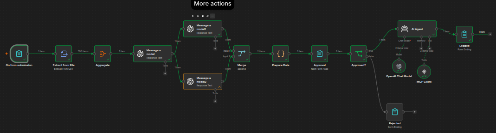
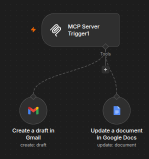
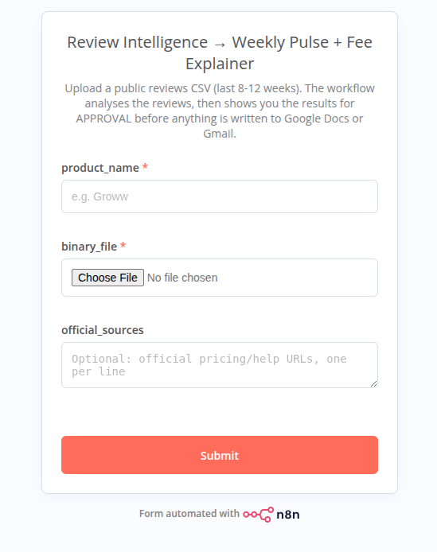
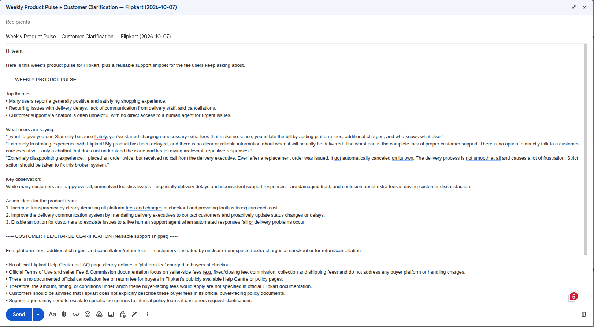

# review-pulse-mcp

AI workflow in n8n that turns app reviews into a weekly product pulse and a fact-checked fee explainer, then logs them to Google Docs and drafts a Gmail email via MCP after human approval.




## What it does

Product teams get hundreds of app-store reviews a week, and the useful signal (recurring complaints, real user voice, confusion about fees) is buried in noise. **review-pulse-mcp** takes a reviews CSV, clusters it into themes, pulls out real quotes, and spots the fee or charge users are most confused about. It then writes a ≤250-word weekly product pulse and a short, source-backed fee explainer for support agents. A small website handles the upload and shows the full analysis (dataset snapshot, themes, quotes, fee explainer, exactly what will be written). Nothing is written anywhere until a human approves it there. After approval, an AI agent uses MCP tools to append the note to a Google Doc and create a Gmail draft, which it never sends.

## Architecture

```mermaid
flowchart LR
    W[/"Website (web/)<br/>product name + reviews CSV"/] -- "POST /review-pulse/analyze" --> A["Analyze Webhook"]
    A --> B[Extract from File]
    B --> C[Aggregate]
    C --> D["Step 1 · Review Intelligence<br/>≤5 themes · top 3 · 3 real quotes · 1 fee confusion"]
    D --> E["Step 2 · Weekly Product Pulse<br/>≤250 words · JSON"]
    D --> F["Step 3 · Fee Explainer<br/>≤6 bullets · 2 official sources · web search"]
    E --> G[Merge]
    F --> G
    G --> H["Prepare Data<br/>(Code node)"]
    H --> I[/"Return Analysis<br/>JSON to website"/]
    I --> X{"Reviewer on website<br/>Approve / Reject"}
    X -- Reject --> R[/"Nothing written"/]
    X -- "Approve: POST /review-pulse/approve" --> AW["Approve Webhook"]
    AW --> K["AI Agent<br/>+ OpenAI Chat Model"]
    K <--> L["MCP Client"]
    K --> M[/"Return Logged"/]

    subgraph S["MCP Server workflow"]
        T["MCP Server Trigger<br/>(Bearer auth)"] --> U["Google Docs<br/>append note"]
        T --> V["Gmail<br/>create draft (never sent)"]
    end

    L -- "MCP over HTTP" --> T
```



More detail, including a map from diagram steps to n8n node names, is in [`docs/architecture.md`](docs/architecture.md).

## Features

- **Theme clustering**: groups all reviews into at most 5 themes and ranks the top 3.
- **Quote extraction**: 3 real user quotes, copied verbatim and never paraphrased.
- **Fee-confusion detection**: identifies the one fee or charge users are most confused about.
- **≤250-word weekly pulse**: top themes, quotes, key observation and 3 action ideas, returned as structured JSON.
- **Fee explainer with official sources**: ≤6 neutral, facts-only bullets, backed by 2 official sources found with web search (no blogs or third-party sites).
- **Web UI**: drag-and-drop CSV upload, live progress, a results dashboard (rating distribution, reviews per week, themes, quotes, fee explainer) and a Markdown report download.
- **Human approval gate**: a reviewer sees the full preview and must approve before anything is written.
- **MCP logging**: an AI agent calls MCP tools to append the note to Google Docs and create a Gmail **draft**. Email is never sent.

## How to run

1. **Import both workflows** into n8n:
   - [`workflows/review-pulse-workflow.json`](workflows/review-pulse-workflow.json) (main)
   - [`workflows/mcp-server.json`](workflows/mcp-server.json) (MCP Server)
2. **Set up credentials** in n8n:
   - **OpenAI** on `Message a model`, `Message a model1`, `Message a model2` and `OpenAI Chat Model`
   - **Gmail OAuth2** on `Create a draft in Gmail` (MCP Server)
   - **Google Docs OAuth2** on `Update a document in Google Docs` (MCP Server). Also replace `YOUR_GOOGLE_DOC_URL` with your target Doc's URL.
3. **Add Bearer auth**: create one Bearer token credential and select it on **both** the `MCP Server Trigger` (Authentication → Bearer Auth) and the `MCP Client` (Authentication → Bearer Auth). They must use the same token.
4. **Activate the MCP Server workflow**, then copy the trigger's **Production URL**.
5. **Paste that URL** into the `MCP Client` node's Endpoint field, replacing `YOUR_MCP_ENDPOINT_URL`.
6. **Check Web Search** is enabled under Built-in Tools on `Message a model2` (the Fee Explainer).
7. **Activate the main workflow.** Copy the Production URLs of `Analyze Webhook` and `Approve Webhook` into [`web/config.js`](web/config.js). Both webhooks allow any origin (`Allowed Origins (CORS)` = `*`); set it to your website's origin if you host it publicly.
8. **Serve the website**: `python3 -m http.server 8080 -d web`, then open <http://localhost:8080>.
9. **Upload the CSV.** Enter a product name, upload a reviews CSV (try [`data/flipkart-play-store-reviews.csv`](data/flipkart-play-store-reviews.csv)) and optionally paste official pricing or help URLs. Analysis takes 1–3 minutes.
10. **Review the results** and choose **Approve & log**. Then check your Google Doc and your Gmail Drafts folder.

> **Long requests:** the analyze call stays open until all three model calls finish. If n8n sits behind a reverse proxy, raise its read timeout above 3 minutes (nginx defaults to 60 s).

## Where MCP approval happens

Approval happens on the website's **Review** page, which shows the full analysis, the Doc note and the email subject and body.

- **Approve**: the website posts the subject, Doc note and email body to `Approve Webhook`, which runs the **AI Agent**. The agent calls the MCP tools (Google Docs append and Gmail draft), and the result is shown on the **Done** page.
- **Reject**: the website never calls n8n again. **Nothing is written** to Google Docs or Gmail.

The AI Agent and the MCP Client are only reachable through `Approve Webhook`. Like the old n8n form, the webhooks are public URLs, so anyone who knows the approve URL can trigger a write. Add Header Auth on the webhooks or put n8n behind your own auth if that matters for your deployment.

## Screenshots

| # | Screenshot | Caption |
|---|---|---|
| 1 |  | Main workflow after a successful run: form → analysis → approval → AI Agent + MCP Client. |
| 2 |  | MCP Server workflow exposing the Gmail draft and Google Docs update tools. |
| 3 |  | Legacy n8n upload form, now replaced by the website in [`web/`](web). |
| 4 | _TODO: add `screenshots/04-website-review.png`_ | Website Review page: dataset snapshot, themes, quotes, fee explainer and Approve/Reject. |
| 5 | _TODO: add `screenshots/05-google-doc-entry.png`_ | Google Doc entry appended via MCP. Until then, see the [PDF export](outputs/weekly-pulse-flipkart-2026-10-07.pdf). |
| 6 |  | Gmail draft created via MCP: weekly pulse plus a reusable fee snippet. Not sent. |

## Fee issue identified from reviews

> **TODO (author):** describe the fee issue found in the reviews, in 2–3 sentences.
>
> For reference, the 2026-10-07 Flipkart run flagged *platform fees, additional charges and cancellation/return fees*. See [`outputs/weekly-pulse-flipkart-2026-10-07.md`](outputs/weekly-pulse-flipkart-2026-10-07.md).

## Deliverables

- [ ] Demo video: _TODO: add link_
- [x] Weekly pulse: [`outputs/weekly-pulse-flipkart-2026-10-07.md`](outputs/weekly-pulse-flipkart-2026-10-07.md) / [`.pdf`](outputs/weekly-pulse-flipkart-2026-10-07.pdf)
- [ ] Google Doc entry: [PDF export](outputs/weekly-pulse-flipkart-2026-10-07.pdf) available; screenshot `05-google-doc-entry.png` TODO
- [x] Gmail draft: [`screenshots/06-gmail-draft.png`](screenshots/06-gmail-draft.png)
- [x] CSV sample: [`data/flipkart-play-store-reviews.csv`](data/flipkart-play-store-reviews.csv)
- [ ] Sources: [`docs/sources.md`](docs/sources.md) (3 of 4–6 filled)
- [x] README

## Repo structure

```
review-pulse-mcp/
├── README.md
├── LICENSE
├── .gitignore
├── workflows/
│   ├── review-pulse-workflow.json   # main n8n workflow
│   └── mcp-server.json              # MCP Server (Google Docs + Gmail tools)
├── screenshots/
│   ├── 01-main-workflow-canvas.png
│   ├── 02-mcp-server-canvas.png
│   ├── 03-upload-form.png
│   └── 06-gmail-draft.png
├── data/
│   ├── README.md
│   └── flipkart-play-store-reviews.csv
├── outputs/
│   ├── README.md
│   ├── weekly-pulse-flipkart-2026-10-07.md
│   └── weekly-pulse-flipkart-2026-10-07.pdf
└── docs/
    ├── architecture.md
    └── sources.md
```

## License

[MIT](LICENSE) © 2026 Jithu J george
