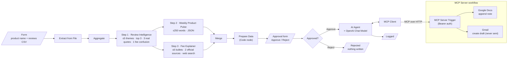

# Architecture

Two n8n workflows work together:

- **Main workflow** ([`workflows/review-pulse-workflow.json`](../workflows/review-pulse-workflow.json)) analyses reviews, builds the outputs, and waits for human approval.
- **MCP Server** ([`workflows/mcp-server.json`](../workflows/mcp-server.json)) exposes two tools, *append to Google Doc* and *create Gmail draft*, over MCP.

## Node map

| Diagram step | n8n node name |
|---|---|
| Form | `On form submission` |
| Step 1 · Review Intelligence | `Message a model` (GPT-4.1) |
| Step 2 · Weekly Product Pulse | `Message a model1` (GPT-4.1) |
| Step 3 · Fee Explainer | `Message a model2` (GPT-4.1 + Web Search) |
| Prepare Data | `Prepare Data` (Code): parses both JSON outputs, builds the Doc note, email subject/body and approval preview |
| Approval form | `Approval` (Form page, Decision dropdown + reviewer notes) |
| IF | `Approved?` (`Decision == "Approve"`) |
| AI Agent | `AI Agent` + `OpenAI Chat Model` (GPT-4.1, temperature 0) + `MCP Client` |
| End pages | `Logged` / `Rejected` |
