# Architecture

Two n8n workflows work together:

- **Website** ([`web/`](../web)) is the user interface: upload, results dashboard, approve/reject.
- **Main workflow** ([`workflows/review-pulse-workflow.json`](../workflows/review-pulse-workflow.json)) exposes two webhooks: one analyses reviews and returns the results as JSON, the other logs approved content via MCP.
- **MCP Server** ([`workflows/mcp-server.json`](../workflows/mcp-server.json)) exposes two tools, *append to Google Doc* and *create Gmail draft*, over MCP.

```mermaid
flowchart LR
    W[/"Website (web/)<br/>product name + reviews CSV"/] -- "POST /review-pulse/analyze" --> A["Analyze Webhook"]
    A --> B[Extract from File]
    B --> C[Aggregate]
    C --> D["Step 1 · Review Intelligence<br/>≤5 themes · top 3 · 3 real quotes · 1 fee confusion"]
    D --> E["Step 2 · Weekly Product Pulse<br/>≤250 words · JSON"]
    D --> F["Step 3 · Fee Explainer<br/>≤6 bullets · 2 official sources · web search"]
    E --> G[Merge]
    F --> G
    G --> H["Prepare Data<br/>(Code node)"]
    H --> I[/"Return Analysis<br/>JSON to website"/]
    I --> X{"Reviewer on website<br/>Approve / Reject"}
    X -- Reject --> R[/"Nothing written"/]
    X -- "Approve: POST /review-pulse/approve" --> AW["Approve Webhook"]
    AW --> K["AI Agent<br/>+ OpenAI Chat Model"]
    K <--> L["MCP Client"]
    K --> M[/"Return Logged"/]

    subgraph S["MCP Server workflow"]
        T["MCP Server Trigger<br/>(Bearer auth)"] --> U["Google Docs<br/>append note"]
        T --> V["Gmail<br/>create draft (never sent)"]
    end

    L -- "MCP over HTTP" --> T
```

## Node map

| Diagram step | n8n node name |
|---|---|
| Website upload | `Analyze Webhook` (POST `review-pulse/analyze`, multipart: `product_name`, `binary_file`, `official_sources`) |
| Step 1 · Review Intelligence | `Message a model` (GPT-4.1) |
| Step 2 · Weekly Product Pulse | `Message a model1` (GPT-4.1) |
| Step 3 · Fee Explainer | `Message a model2` (GPT-4.1 + Web Search) |
| Prepare Data | `Prepare Data` (Code): parses both JSON outputs, builds the Doc note, email subject/body and checks; also returns the raw `pulse`/`fee` objects and the Step 1 analysis text |
| Return Analysis | `Return Analysis` (Respond to Webhook): sends Prepare Data's output to the website |
| Approval | The website's **Approve / Reject** buttons. Reject never calls n8n. |
| Approve | `Approve Webhook` (POST `review-pulse/approve`, form-encoded: `subject`, `doc_note`, `email_body`) |
| AI Agent | `AI Agent` + `OpenAI Chat Model` (GPT-4.1, temperature 0) + `MCP Client` |
| Return Logged | `Return Logged` (Respond to Webhook): `{status, output, subject}` |
